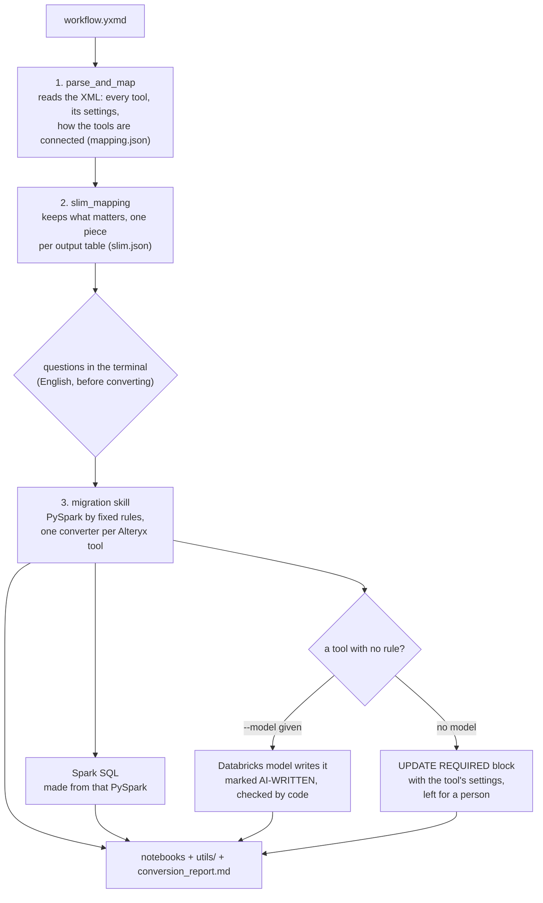
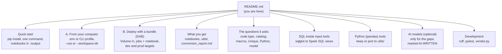
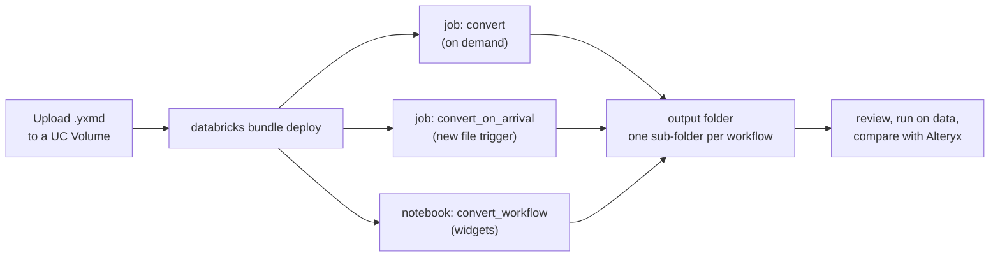

# alteryx-converter

Turns an Alteryx workflow (`.yxmd`) into Databricks notebooks. You give it the workflow, it asks you a few questions in plain English, and it writes
ready-to-review **PySpark** and **Spark SQL** notebooks (Bronze / Silver / Gold). Only the transformation is converted: the tables the workflow reads must already exist.

> **Converted, not yet validated.** Nothing is compared with real Alteryx output. Review the notebooks, run them on your data and compare the result before you rely on them.

## Contents

1. [How it works](#how-it-works) and [Workflows at a glance](#workflows-at-a-glance)
2. [Folder structure](#folder-structure)
3. [Quick start](#quick-start)
4. [Run it from your computer](#a-from-your-computer)
5. [Deploy to your workspace with a bundle (DAB)](#b-deploy-to-your-workspace-with-a-bundle-dab)
6. [What you get](#what-you-get)
7. [The questions it asks](#the-questions-it-asks)
8. [Options](#options)
9. [SQL inside the input tools](#sql-inside-the-input-tools), [Python code](#python-pandas-code-is-a-component-file), [AI models](#ai-models-optional-any-databricks-model)
10. [Development](#development)

## How it works

In simple terms: **read the workflow, understand it, write the code**. Three existing tools do the work; this package only connects them.



Rules that always hold:

- **The skill does the converting.** The model is only asked about the gaps, never about a table the rules can convert, and everything it writes is checked by code and marked for review.
- **Nothing is guessed.** If the workflow does not say something (which row *Unique* keeps, what a missing macro does) you are asked; if a tool cannot be converted it is reported with the reason, never replaced by a stub.
- **No secrets are written** into any generated file. Your token is read from the environment or a git-ignored `.env`.
- **The Spark SQL is not a second set of rules.** It is produced from the generated PySpark and tested against it, so the two agree.

## Workflows at a glance

Same idea as a docs map: start at this README and follow the branch you need. (Mermaid, rendered by GitHub and by VS Code's Markdown preview.)



**Deployment workflow** (bundle):



## Folder structure

```
alteryx-converter/
|-- alteryx_migrate/                the package
|   |-- cli.py                      command line: `convert` and `models`, exit codes
|   |-- interactive.py              the questions asked in the terminal
|   |-- pipeline.py                 workflow in -> notebooks out (the main flow)
|   |-- engine.py                   adapter over parse_and_map, slim_mapping and the skill
|   |-- templates.py                how the notebooks, the report and the hand-offs look
|   |-- sqlsrc.py                   SQL inside input tools -> Spark SQL views (sqlglot)
|   |-- pytool.py                   embedded Python (pandas) tools -> utils/ files
|   |-- ai.py                       Databricks model client (AI Gateway and serving endpoints) and output checks
|   |-- workspace.py                write into a Databricks workspace folder, read table columns
|   |-- env.py, paths.py, versions.py   .env loading, tool locations, skill version
|   `-- vendor/                     committed copy of parse_and_map, slim_mapping and the migration skill
|-- notebooks/convert_workflow.py   Databricks notebook with widgets (deployed by the bundle)
|-- jobs/run_convert.py             entry point of the two jobs
|-- resources/jobs.yml              the jobs: `convert` (on demand) and `convert_on_arrival` (new file in the Volume)
|-- databricks.yml                  the Asset Bundle: variables, dev and prod targets
|-- scripts/vendor.py               refreshes alteryx_migrate/vendor/ from the source tools
|-- tests/                          pytest suite and sample workflows
|-- requirements.txt, requirements-dev.txt, pyproject.toml
`-- .env.example                    copy to `.env` for local credentials
```

`alteryx_migrate/vendor/` is committed on purpose, so a plain `git clone` deploys and runs with no extra step. Run `python scripts/vendor.py` only when the source tools change.

## Quick start

You need Python 3.10+. The shortest path:

```powershell
pip install -r requirements.txt
python -m alteryx_migrate convert "C:\path\Revenue.yxmd"
```

It reads the workflow, asks its questions, and writes the notebooks into `.\output\Revenue\` (inside the folder you run it from). Open them in Databricks or any editor.

### A. From your computer

Use this when the workflow is a file on your disk. Nothing is uploaded to a Volume first.

1. **Install:** `pip install -r requirements.txt`
2. **Sign in** (only for `--workspace-dir`, `--model` and reading table columns): copy `.env.example` to `.env` and set `DATABRICKS_HOST` and `DATABRICKS_TOKEN`, or run `databricks auth login` and pass `--profile <name>`.
3. **Convert:**

```powershell
# to a local folder (default .\output\<workflow>\)
python -m alteryx_migrate convert "C:\path\Revenue.yxmd"

# straight into your workspace
python -m alteryx_migrate convert "C:\path\Revenue.yxmd" --workspace-dir /Workspace/Users/<you>/migrations --catalog <catalog> --schema <schema>

# a whole folder of workflows, no questions (for scripts)
python -m alteryx_migrate convert "C:\workflows" --yes --out C:\out
```

Exit code `0` = everything converted, `2` = converted but some tools need an update (see `conversion_report.md`), `1` = the command failed.

### B. Deploy to your workspace with a bundle (DAB)

Use this to run the converter inside Databricks, on files in a Unity Catalog Volume. One bundle deploys a notebook and two jobs.

1. **Install the Databricks CLI** and sign in: `databricks auth login --host https://<workspace>`
2. **Upload your `.yxmd` files** to a Volume folder (Catalog > your volume > Upload to this volume), e.g. `/Volumes/main/migration/files/alteryx`.
3. **Deploy:**

```bash
databricks bundle validate -t dev --var input_path=/Volumes/main/migration/files/alteryx --var output_path=/Volumes/main/migration/files/notebooks
databricks bundle deploy   -t dev --var input_path=/Volumes/main/migration/files/alteryx --var output_path=/Volumes/main/migration/files/notebooks \
                           --var catalog=main --var schema=migrated        # catalog and schema are optional
```

4. **Run:**
   - **Job, on demand:** `databricks bundle run convert -t dev` converts every `.yxmd` / `.yxzp` in `input_path` into `output_path` (one sub-folder per workflow).
   - **Job, on arrival:** `convert_on_arrival` starts by itself when a new file lands in the folder. It is deployed paused; unpause it in the job's *Schedules & Triggers*.
   - **Notebook, by hand:** open `convert_workflow` in `/Workspace/Users/<you>/.bundle/alteryx-converter/dev/files/notebooks/`, fill in the widgets (workflow path, output folder, catalog, schema, optional decisions and model) and run it. The notebooks are written with the sign-in of whoever runs it.
5. **Production:** `databricks bundle deploy -t prod ...` installs it under `/Workspace/Shared/.bundle/alteryx-converter/prod`. Set `catalog` and `schema` once under `targets:` in `databricks.yml` instead of repeating `--var`.

The jobs run on serverless compute; their Python dependencies (`lxml`, `networkx`, `sqlglot`, `databricks-sdk`) are declared in `resources/jobs.yml`. A job cannot ask questions, so it uses the defaults and
lists anything that needs your answer in `unconverted_tools.json`; give those answers with a decisions file (see [Options](#options)) and run again.

## What you get

For `Revenue.yxmd` the output folder holds:

| File | What it is |
|---|---|
| `00_config.ipynb` | table names (`INPUTS`, `OUTPUTS`), catalog and schema |
| `01_bronze.ipynb` | reads the input tables; input tools that carry SQL become views |
| `02_silver.ipynb`, `03_gold.ipynb` | the transformations as plain PySpark, one block per Alteryx tool, per output table |
| `02_silver_sql.ipynb`, `03_gold_sql.ipynb` | the same tables as `CREATE TABLE ... AS WITH ...` Spark SQL |
| `utils/python_tool_<id>.py` | the code of an embedded Python tool, called from silver/gold |
| `conversion_report.md` | what converted, what needs an update, what a model wrote, which skill version ran |
| `unconverted_tools.json` | the tools that wait for you: id, name, container, reason |
| `python_port.json` | only when a Python tool was handled: what was kept or ported, and any open question |

A tool with no converter has an **`UPDATE REQUIRED`** cell: tool number, name, position, why, and a hand-off (the tool's original settings, the recipe, input and output) that a person or another AI can finish from.
Every Alteryx tool is documented (what it does, its settings, the PySpark and Spark SQL recipe, what the help leaves unstated) in
[`14-tool-coverage.md`](alteryx_migrate/vendor/skills/alteryx-databricks-pyspark-migration/references/14-tool-coverage.md).

## The questions it asks

In a terminal it first reads the workflow, then asks. Press Enter to accept the answer in [brackets]; `--yes` skips all questions.

1. **Which code do you need?** PySpark, Spark SQL, or both.
2. **Which catalog and schema** hold the tables (Enter = none: names are not qualified and the notebooks use the catalog and schema that are current when they run).
3. **Where are the source tables** of the SQL inside input tools, and which database dialect it is.
4. **A macro without a definition?** Say in English what it does (or give the `.yxmc` path).
5. **Which row does a Unique tool keep?** Any, or sorted by fields you name.
6. **An embedded Python script?** Keep the pandas code in a util file, port it to PySpark with a model, or leave it.
7. **Any other tool without a converter:** what must it do here?
8. **Which Databricks model** may write what the rules cannot (Enter = none).

## Options

| Option | Meaning |
|---|---|
| `--out <folder>` | parent folder, local or Volume; each workflow gets its own `<workflow>\` subfolder (default `.\output\<workflow>\`) |
| `--workspace-dir <path>` | write into this workspace folder instead; `--profile` picks the CLI profile |
| `--catalog`, `--schema` | where the tables live (also env `CATALOG`, `SCHEMA`); optional |
| `--format pyspark\|sql\|both` | which code to write |
| `--decisions file.json` | answers instead of questions, e.g. `{"20": {"mode": "order_by", "fields": ["Date"], "ascending": false}}` or `{"20": {"mode": "any"}}` |
| `--schemas file.json` | columns of input tables the workflow does not describe: `{"bronze_orders": ["OrderId", "Amount"]}` (needed for Spark SQL when the table is not readable) |
| `--python keep\|port\|none` | what to do with an embedded Python tool |
| `--model <endpoint>` | a Databricks-served model for the gaps (see below) |
| `--sql-dialect`, `--source-catalog`, `--source-schema` | for the SQL inside input tools |
| `--yes` / `--interactive` | never ask / ask even without a terminal |

`python -m alteryx_migrate models` lists the models you can use.

## SQL inside the input tools

An Alteryx input (BigQuery Input, a database Input) often carries a query that already renames columns, filters, joins, sub-selects and aggregates; the tools after it depend on that.
So the query is **parsed and converted to Spark SQL** (with [sqlglot](https://github.com/tobymao/sqlglot), in the query's own dialect: BigQuery is recognised by itself, otherwise
`--sql-dialect` or the question in the terminal) and `01_bronze` creates a **view** with the name the other notebooks read:

```python
spark.sql("CREATE OR REPLACE VIEW " + INPUTS['bronze_ekko_v'] + " AS\n" + r"""SELECT AEDAT AS PO_Date, WAERS AS Currency ... FROM main.sap_data.EKKO_V WHERE ...""")
```

- **Where the source tables are:** `--source-catalog` / `--source-schema` (default: `--catalog`, and the dataset written in the query, e.g. `sap_data`). The first cell checks they exist.
- **Types keep their meaning:** a `DECIMAL`/`NUMERIC` without precision is `(38,9)` in BigQuery and `(18,0)` in SQL Server; Spark's default `(10,0)` would silently cut the fraction, so the precision is written out.
- **Columns come for free:** the columns the query lists are the columns of the view, so the Spark SQL notebooks need no schema file (only `SELECT *` queries do).
- A query that does not parse (for example one with an Alteryx `%Question%` placeholder) is not guessed: the cell quotes the original SQL and says why.

## Python (pandas) code is a component file

An embedded Python (Jupyter) tool is **never inlined as a wall of cells**. Its code goes into **`utils/python_tool_<id>.py`**, a `utils` package written next to the notebooks, and silver/gold only call it where the
tools after it need its result:

```python
from utils import python_tool_17
silver_x, silver_y = python_tool_17.run(spark, bronze_a, bronze_b)
```

`run(spark, input_1, ...)` takes the DataFrames the script read with `Alteryx.read("#n")` and returns the ones it wrote with `Alteryx.write(df, k)` that the next tools read. The script is
parsed (`ast`) into cells and into the cells each output needs; there are two ways to fill the file (`--python`, or the question in the terminal):

| `--python` | What the component contains | Needs a model | Trade-off |
|---|---|---|---|
| **`keep`** (default) | the author's **original pandas code, unchanged**; only `Alteryx.read("#n")` -> `input_n.copy()`, `Alteryx.write(df, k)` -> `output_k = df` and the `ayx` imports are rewritten; inputs come in with `toPandas()`, outputs go back with `createDataFrame` (NaN -> NULL) | no | exactly the script's logic, so no translation risk; it runs on the **driver**, so the data must fit in memory (it did in Alteryx, which ran it on one machine) |
| `port` | the script **ported to PySpark** cell by cell by a Databricks model, checked by code, with questions to you whenever it would have to guess | yes (`--model`) | scales, but is a translation: review it and compare with Alteryx |
| `none` | nothing: the tool stays a hand-off with the original code | no | |

A script that uses Alteryx features with no counterpart outside Alteryx (`Alteryx.readMetadata`, a non-literal `Alteryx.read(name)`) cannot be kept; the report says which cell. `--inline-python` puts a
ported script in the notebook instead of a file.


## AI models (optional, any Databricks model)

`--model <name>` (or the **model** widget of the notebook) lets a model served by Databricks write the tables the skill cannot convert by rule. Nothing is sent anywhere without it.

```bash
python -m alteryx_migrate models --profile <cli profile>              # the serving endpoints you can use
python -m alteryx_migrate convert wf.yxmd --catalog c --schema s --out out/ --profile <cli profile> --model databricks-meta-llama-3-3-70b-instruct
python -m alteryx_migrate convert wf.yxmd ... --model alteryx.default.test                              # a Unity Catalog model service behind the AI Gateway
```

- **Any model name works.** The client tries the AI Gateway (`/ai-gateway/mlflow/v1`: Responses API, then chat completions; for names like `alteryx.default.test`) and then `/serving-endpoints`
  (Foundation Model and custom endpoints such as `databricks-gpt-oss-120b`), and remembers the door that answered. Another gateway URL: `--base-url`.
- **Your credentials, never stored:** `DATABRICKS_TOKEN` (environment variable, or a git-ignored `.env` file: copy `.env.example` to `.env`), or your CLI profile / notebook sign-in. No token is written to a file or shown in a message.
- **Only the gap goes to the model**, with the skill's rules as the system prompt, the slimmed settings of the table's tools and the hand-off context. A table the skill converts is never sent.
- **A decision is yours, not the model's:** a table that waits for a decision (which row Unique keeps, a record order) is not sent; you answer it with `--decisions`.
- **The model's code is checked** (parses, no collect/toPandas/UDF/TODO/secrets, reads tables through `INPUTS[...]`, ends with `write_output`), repaired once, and written marked `AI-WRITTEN` with the
  model's name; the report lists it under "Written by a model". If it still fails, the table keeps its `UPDATE REQUIRED` hand-off and says the model could not write it. AI tables get no Spark SQL.
- **Converted, not yet validated** applies even more to these tables: review them first.

## Development

```powershell
pip install -r requirements-dev.txt        # the Spark tests need Java 17 (set JAVA_HOME)
ruff check alteryx_migrate jobs scripts tests
python -m pytest -q
python scripts/vendor.py                   # only to refresh alteryx_migrate/vendor/ from ..\parse_and_map, ..\slim_mapping and ..\skills
```

CI (`.github/workflows/ci.yml`) runs the lint and the tests on every pull request. Not included on purpose: assessment, reconciliation and any UI.
